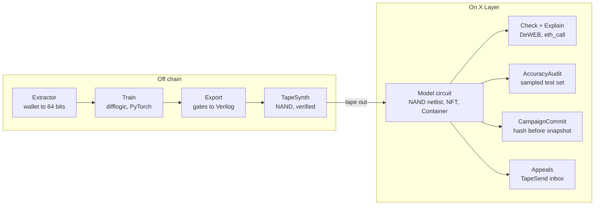

# Cusity: Build Spec

Nov 18, 2026 · @Lino

> Renamed from the "Weightless: Build Spec" PDF. Only the name changed: Weightless → Cusity,
> `weightless` → `cusity` (folders, files, Verilog module), `WeightlessRegistry` → `CusityRegistry`.
> Technical content is otherwise as written, except for the three blocker fixes listed in
> [`SPEC_REVIEW.md`](./SPEC_REVIEW.md) §1: tapered layer widths, vendored difflogic for CPU, and a
> local `./tapesynth` wrapper instead of `./tapesynth`.

Cusity ships one logic-gate bot filter, taped out on X Layer and checkable from a DeWEB page, by the TapeOut Accelerate deadline on **Dec 7, 2026**.

## What v1 is

v1 is one bot-filter model, trained as a logic gate network, compiled to NAND and taped out on X Layer mainnet. It sits behind a DeWEB page where anyone can check a wallet, see why, and audit the model.

**Ships by Dec 7:**

1. One taped-out model circuit (target 1,000 to 3,000 NAND gates) with a verdict output and a score output.
2. A deterministic feature extractor that turns any X Layer wallet into 64 bits, with its code hash pinned.
3. Three contracts: `CusityRegistry` (model cards), `CampaignCommit` (commit before snapshot, match after tape-out) and `AccuracyAudit` (sampled test vectors, scored on chain).
4. A DeWEB site with four views: Check, Explain, Audit and Appeal (Appeal goes through TapeSend).
5. One live campaign run on it with real wallets before submission.

**Not in v1:** no token, no model marketplace, no training UI, no LLM, no second model and no mobile app.

**The one rule for the whole build.** Prove a learned model answers from chain in week one, using a toy dataset. Only then touch wallet data.

## Architecture

Everything before the tape-out happens on your machine. Everything after it reads from one circuit on X Layer.

**One taped-out circuit serves every check, audit and appeal**



*Cusity architecture · 4 build steps, 1 circuit, 4 uses*

The model circuit is the only source of truth. The three contracts and the site read it, and none of them can change it.

## Prerequisites and setup

You need two wallets, a little OKB on X Layer, and five tools installed before writing any code.

**Wallets and accounts.**

| Item | Purpose | Notes |
|---|---|---|
| Deployer wallet | Tapes out circuits, deploys contracts, owns the model | Fresh wallet, holding only the OKB this project needs |
| Test wallet | Plays the user in demos and audits | Separate from the deployer |
| OKB on X Layer | Transistor mints, tape-out, container fee, gas | Fund after the TapeSynth dry run tells you the total |
| GitHub repo | Public code for judges | Public from day one |
| Explorer API key (optional) | Wallet history for the extractor | Only if you use an explorer API rather than your own indexer |

**Tools.**

| Tool | Version | Install |
|---|---|---|
| Node.js | 22 (TapeSynth requires it) | `nvm install 22` |
| Python | 3.10 or newer | System or pyenv |
| PyTorch + difflogic | torch 1.13 or newer; difflogic 0.1.0 (vendored) | `pip install torch scikit-learn numpy pandas`, then `python model/vendor_difflogic.py` (see Bootstrap) |
| Foundry | Latest | `curl -L https://foundry.paradigm.xyz` then `foundryup` |
| TapeSynth | Latest main | `git clone --recurse-submodules https://github.com/Cheeeeez/tapesynth` |

**Bootstrap.**

```bash
mkdir cusity && cd cusity && git init
mkdir -p data model compiler contracts web build

# TapeSynth as a sibling tool
git clone --recurse-submodules https://github.com/Cheeeeez/tapesynth ../tapesynth
cd ../tapesynth && npm install && npm run build:libs && cd ../cusity

# Call TapeSynth through a local wrapper, never `npx tapesynth`: the CLI is a private
# workspace package (@tapesynth/cli), and the name "tapesynth" is unclaimed on npm, so
# npx outside the TapeSynth repo would download whatever package holds that name,
# with PRIVATE_KEY in the environment.
cat > tapesynth <<'EOF'
#!/usr/bin/env sh
exec node "$(dirname "$0")/../tapesynth/packages/cli/dist/index.js" "$@"
EOF
chmod +x tapesynth && ./tapesynth --help

# Python env
python -m venv .venv && source .venv/bin/activate
pip install torch scikit-learn numpy pandas
# difflogic from PyPI always compiles a CUDA extension and imports it on load, so it
# can't install or import on a CPU-only machine. Vendor its pure-Python modules into
# model/difflogic/ with the CUDA import made optional (code in A7), and commit them.
python model/vendor_difflogic.py

# Contracts
cd contracts && forge init --no-git --force . && forge install OpenZeppelin/openzeppelin-contracts --no-git && cd ..

# Web
npm create vite@latest web -- --template vanilla-ts && cd web && npm i viem && cd ..
```

**Environment** (`.env`, never committed).

```bash
PRIVATE_KEY=0x...            # deployer; also read by tapesynth tapeout
XLAYER_RPC=https://rpc.xlayer.tech
XLAYER_RPC_2=...             # second RPC to race (drpc or tapeout.net)
CHAIN_ID=196
PROCESSOR=0x...              # chosen processor
MODEL_CIRCUIT_ID=...         # filled after tape-out
REGISTRY=0x...  CAMPAIGN=0x...  AUDIT=0x...   # filled after deploy
EXPLORER_API_KEY=...         # optional
```

Add `.env`, `data/raw/` and any label file with personal notes to `.gitignore`.

## TapeOut protocol reference

Everything here comes from the TAP-02 draft (Circuit Netlist Format and Evaluation Semantics). Cusity only uses NAND records and pure evaluation, which is the simplest part of the spec.

**Netlist bytes.** The on-chain netlist has no header: it is just records placed one after another, with no padding and no terminator. `nIn` and `nOut` are not part of the bytes. They are passed to `tapeout` and stored next to the netlist (TAP-02). The 16-byte header belongs to the separate tapnet/1 file format proposed in the TAP-721 draft, not to the on-chain netlist.

**Signal numbering.** Index 0 is constant 0, index 1 is constant 1, input *i* sits at index 2+*i*, and element outputs follow in record order (TAP-02). The outputs are the last `nOut` signals, and they must come from elements, never from inputs or constants (TAP-02).

**Records.** Encoding is big-endian. A NAND record (opcode `0x00`) is 7 bytes, `a:u24` then `b:u24`, and produces NOT(a AND b). A LATCH record (opcode `0x01`) is 4 bytes, `d:u24`, and produces its stored state bit (TAP-02). There is also a REF record that pulls in another circuit, but TapeSynth flattens REFs, so the Cusity netlist should contain only NAND records.

**Bit packing.** Bit *i* is bit (*i* mod 8) of byte floor(*i*/8), LSB first. Outputs come back as exactly ceil(n/8) bytes with zero padding (TAP-02). For Cusity, the 64 input bits are 8 bytes, and input bit 0 is the lowest bit of byte 0.

**Rules a netlist must follow.** NAND inputs must point to a smaller index than the element's own output, so references only point backward (TAP-02). `tapeout` enforces the rules and reverts on the first failure, with reasons such as `bad opcode`, `no outputs` and `NAND: future signal` (TAP-02).

**eval vs step.** `eval` is for circuits with no state. On a circuit with latches it reverts with `has latch: use step` (TAP-02). The model has no latches, so every call is `eval`.

**Processor functions Cusity uses.** These are listed in the TAP-02 draft (TAP-02):

| Function | Selector | Returns | Used by |
|---|---|---|---|
| `circuitInfo(uint256 id)` | `0x084d60f1` | `(uint32 nIn, uint32 nOut, uint32 nState, uint32 gateCount)` | Registry checks shape |
| `netlist(uint256 id)` | `0x3fc4be56` | `bytes` | Netlist hash, Explain view |
| `eval(uint256 id, bytes inputs)` | `0x934d06ea` | `bytes`, the packed outputs | Check, Audit |
| `tapeout(bytes netlist, uint32 nIn, uint32 nOut) payable` | `0x7bd3ac1d` | `uint256 id` | TapeSynth does this for you |

One caveat: those functions were checked on BNB Smart Chain mainnet, while the Base and X Layer deployments are listed but not verified against the text (TAP-02). Confirm each selector against the X Layer processor with a single `cast call` before building on it.

## Model pipeline

The model takes 64 input bits and returns a verdict bit plus a small score, trained with difflogic and capped by a hard gate budget.

**Dataset (decide on day one).** I have not verified a clean public, labeled bot or sybil dataset for X Layer.

- **Plan A:** a published sybil list from a past airdrop that has usable labels and a license that allows this. Map its addresses to on-chain features.
- **Plan B:** label your own data. Run the campaign's sign-up first, label obvious bot clusters (same funder, same timing, same amounts), and hand-check a sample.
- **Plan C (pipeline proof only):** a public tabular dataset that difflogic's own experiments already use, such as Adult or Breast Cancer (difflogic).

Split the data 70/15/15 into train, validation and test. Hash the test file and commit that hash on chain before training (see On-chain).

**Features: 64 bits, thermometer-encoded.** Every feature becomes a set of threshold bits (for example: age > 7 days, > 30 days, > 90 days, > 180 days). Thermometer bits keep order information and train well in gate networks. Suggested set:

| Feature | Bits | What it measures |
|---|---|---|
| Wallet age | 6 | Days since first transaction |
| Transaction count | 6 | Total outgoing transactions |
| Distinct contracts | 6 | How many contracts it touched |
| Distinct counterparties | 6 | How many wallets it sent to or received from |
| Funder cluster size | 8 | How many wallets share its first funder |
| Amount uniformity | 6 | Share of transfers with repeated exact amounts |
| Timing regularity | 6 | Spread of transaction hours and gaps |
| Gas uniformity | 4 | Same gas settings on every transaction |
| Activity burst | 6 | Share of activity inside the campaign window |
| Balance profile | 6 | Native and stablecoin balance buckets |
| Flags | 4 | Is a contract, has a name, funded from a known exchange, swept to the funder |

The extractor is a deterministic TypeScript script that reads X Layer RPC (chain 196) up to a fixed snapshot block. Same wallet and same block always give the same 64 bits. Publish its code and pin its SHA-256 in the model card.

**Training.**

- **Library:** difflogic 0.1.0, vendored into `model/difflogic/` by `model/vendor_difflogic.py` (A7), with `implementation='python'` on CPU. A model this small trains in seconds to minutes on a laptop. The PyPI package can't be used on CPU: it always builds a CUDA extension and imports it when loaded. On a CUDA machine you can instead `pip install --no-build-isolation difflogic` after installing torch, but CPU training is enough here.
- **Architecture:** `Sequential(LogicLayer(64, w1), LogicLayer(w1, w2), …, LogicLayer(wk, 2·G), GroupSum(k=2, tau))`. difflogic asserts `out_dim * 2 >= in_dim` for every layer, so **each layer must be at least half the width of the one before it**, and the last hidden width must be at most 4·G. Start at widths 256, 128, 64 with G = 16 output neurons per class (64 → 256 → 128 → 64 → 32). A flat `W, W, …, 2·G` stack fails that assertion.
- **Training settings:** `CrossEntropyLoss`, Adam at a learning rate of 0.01 (the library's recommendation), and `grad_factor` 1.1, raised to about 2 for deeper nets (difflogic).
- **Class imbalance:** weight the loss, or oversample bots.
- **Discretize:** `model.eval()` gives the hard gate network.

**Pruning and the gate budget.** After discretization, drop every gate whose output never reaches the final layer, and fold constant gates (always-0, always-1, or pass-through A or B). Then run Yosys and ABC through TapeSynth (see Gate compiler) and read the real NAND count.

**Budget:** at most 3,000 NAND gates including the popcount and comparator. If the model is over budget, shrink W or remove layers before giving up accuracy.

**Outputs.** `verdict` (1 bit: bot or not) and `margin` (6 bits: the bot-group popcount minus the human-group popcount, offset to stay positive). The margin drives the "how close was it" bar in the Explain view.

## Data formats

Five files move data through the pipeline. Fix their shapes on day one so training, contracts and the web page agree.

**1. `data/labels.csv`** holds your ground truth. It never leaves your machine if it carries private notes.

```csv
address,label,source,note
0xabc...,1,funder-cluster,shares funder with 212 wallets
0xdef...,0,manual,known active user
```

`label` is 1 for a bot and 0 for a human. `source` records how the label was decided.

**2. `data/vectors.jsonl`** has one line per labeled wallet, the extractor's output plus the label.

```json
{"address":"0xabc...","bits":"0x1f00a3c4000081ff","label":1,"block":41234567}
```

`bits` is the 8-byte packed vector as hex. Byte 0 holds bits 0 to 7, with bit 0 as its lowest bit, matching TAP-02 packing.

**3. `data/test_leaves.json`** is the test split, frozen and committed before training ends.

```json
{"root":"0x...","size":600,"leaves":
 [{"index":0,"bits":"0x...","label":1,"leaf":"0x...","proof":["0x..."]}]}
```

Each leaf is `keccak256(abi.encodePacked(uint32 index, bytes8 bits, bool label))`, built with OpenZeppelin's sorted-pair Merkle tree so the contract can verify it.

**4. `build/snapshot_vectors.json`** holds every campaign wallet's bits at the snapshot block. It is published on DeWEB, and its root goes on chain.

```json
{"campaignId":1,"block":41300000,"extractorHash":"0x...","root":"0x...",
 "wallets":{"0xabc...":{"bits":"0x...","proof":["0x..."]}}}
```

The leaf is `keccak256(abi.encodePacked(address wallet, bytes8 bits))`.

**5. `build/model_card.json`** is the public description of the model, linked from the registry by `cardURI`.

```json
{"name":"Cusity bot filter v1","processor":"0x...","circuitId":0,"netlistSha256":"0x...",
 "nIn":64,"nOut":7,"gates":0,"outputs":{"verdict":0,"marginBits":[1,6]},
 "features":"see data/features.ts","extractorSha256":"0x...","testRoot":"0x...",
 "testAccuracy":0.0,"trainedOn":"...","limits":"Only as honest as its inputs. Not a ban list."}
```

Read the `outputs` pin positions from the `pins` field TapeSynth writes into `.tsyn.json`, not from memory (TapeSynth).

## Gate compiler

You don't need to write a TAP-02 encoder. Export the trained model as Verilog, then let TapeSynth synthesize, verify and tape it out.

**Why TapeSynth.** It turns Verilog or PLA into a synthesized, optimized and verified TAP-02 netlist (NAND/LATCH), tapes it out on X Layer, and checks the result against the chain's own `eval` and `step` (TapeSynth). It is MIT-licensed and needs Node 22 (TapeSynth).

**Step 1: model to Verilog (`compiler/export_verilog.py`).** For each `LogicLayer`, read the two input indices per neuron and take the argmax over its 16 gate weights. Emit one `assign` per neuron:

```verilog
module cusity (input [63:0] x, output verdict, output [5:0] margin);
  wire [255:0] l1; wire [255:0] l2; wire [31:0] l3;
  assign l1[0] = x[12] & ~x[40];   // op 2: A and not B
  assign l1[1] = ~(x[3] & x[7]);   // op 14: NAND
  // ... one line per surviving neuron
  wire [4:0] human = l3[0]+l3[1]+...+l3[15];   // popcount, class 0: GroupSum's first group
  wire [4:0] bot   = l3[16]+...+l3[31];        // popcount, class 1 (fixed: was swapped, review 3.1)
  assign verdict = bot > human;
  assign margin  = 6'd32 + bot - human;
endmodule
```

The usual difflogic order for the 16 ops is 0 FALSE, 1 AND, 2 A AND NOT B, 3 A, 4 NOT A AND B, 5 B, 6 XOR, 7 OR, 8 NOR, 9 XNOR, 10 NOT B, 11 A OR NOT B, 12 NOT A, 13 NOT A OR B, 14 NAND, 15 TRUE. The README doesn't list them; this order has been checked against `bin_op` in difflogic 0.1.0's `functional.py` and matches.

**Step 2: check the export against PyTorch.** Run the Verilog through TapeSynth's simulator, and the discretized model through PyTorch, on the whole test set. The bits must match exactly. If even one row differs, the export has a bug.

**Step 3: synthesize to NAND.** TapeSynth runs Yosys and ABC to map logic to NAND gates and keeps the best of several ABC flows by area, depth or PoD cost (TapeSynth). Every netlist is simulated against the pre-ABC design. Designs with more than 16 inputs get 4,096 random vectors, and a netlist that fails is never returned (TapeSynth).

```bash
./tapesynth synth model/cusity.v --top cusity --objective area --out build/cusity.tsyn.json
./tapesynth info build/cusity.tsyn.json
./tapesynth sim build/cusity.tsyn.json --inputs 0x<64-bit vector>
```

Input bits follow the module's declaration order, LSB first (TapeSynth). Your extractor has to pack bits in that same order.

**Watch the size limits.** TapeSynth's free API caps a job at 5,000 gates, and its Pro API goes to 50,000 (TapeSynth). Check whether a local build skips the API cap. Either way, the 3,000-gate budget fits.

**Step 4: your own bit-exact evaluator (`compiler/tap02.py` and `web/src/tap02.ts`).** The parity test and the Explain view both need every internal wire value, not just the outputs. TAP-02 is simple enough to evaluate in about 30 lines: read 7-byte NAND records, number signals as in the protocol reference, and compute each NAND in order. The draft also points to an official Python reference evaluator at `assets/tap-02/reference.py`, about 140 lines (TAP-02). Diff yours against it. Both versions are in the appendix. Test them against the chain's `eval` on 100 random inputs.

## On-chain

The model circuit is the source of truth. Three small contracts sit around it to record what was promised, prove accuracy, and list models. None of them can change the model.

**Network.** X Layer mainnet, chain ID 196, public RPC `https://rpc.xlayer.tech` (Fusebox). The public RPCs cap `eth_getLogs` ranges at about 100 to 1,000 blocks, and tapeout.net sometimes hangs, so race several RPCs and cache an event index (Fusebox).

**Tape-out flow.**

1. Choose a processor. One whose transistors are sold out can't mint, so you would have to buy on its market (TapeSynth). The other option is to create your own with `processor create --name --symbol --story --supply --price`. Its settings are fixed forever, so pick them carefully (TapeSynth).
2. Tape out with `./tapesynth tapeout build/cusity.tsyn.json --processor <address|number> --mint`. It reads fees live, mints missing transistors, simulates the call, prints the plan for you to confirm, then sends and verifies `circuitInfo`, the netlist bytes and `eval`/`step` on chain (TapeSynth).
3. Record the processor address and circuit ID. The submission form requires both.
4. Run `./tapesynth verify <processor> <id> --against build/cusity.tsyn.json` (TapeSynth).

**Calling the model.** For a user's check, the page calls the processor's `eval(uint256 id, bytes inputs)` with `eth_call` and gets back the packed outputs (TAP-02). A read-only evaluation needs no transaction or signature (CircuitDesk). Contracts call the same function. All processor calls go through one interface, so only one file changes if X Layer differs:

```solidity
interface ITapeOutProcessor {
  function circuitInfo(uint256 id) external view returns (uint32 nIn, uint32 nOut, uint32 nState, uint32 gateCount);
  function netlist(uint256 id) external view returns (bytes memory);
  function eval(uint256 id, bytes calldata inputs) external view returns (bytes memory);
}
```

**Contract 1: `CusityRegistry`.** A list of model cards.

```solidity
function register(address processor, uint256 circuitId, bytes32 extractorHash,
                  uint256 testCommitId, string calldata cardURI) external returns (uint256 modelId);
// on-chain checks: nIn == 64, nState == 0, netlistHash = sha256(processor.netlist(circuitId))
function check(uint256 modelId, bytes8 bits) external view returns (bool verdict, uint8 margin);
```

The full source is in the appendix.

**Contract 2: `CampaignCommit`.** This contract proves the filter didn't change after the snapshot, and that every wallet's input bits were fixed at the snapshot.

```solidity
function commit(bytes32 netlistHash, bytes32 extractorHash, uint64 snapshotBlock) external returns (uint256 campaignId); // before snapshot
function publishVectors(uint256 campaignId, bytes32 vectorsRoot, string calldata vectorsURI) external;                // after snapshot
function bind(uint256 campaignId, uint256 modelId) external;   // after tape-out: registry hash must equal committed hash
function verdictOf(uint256 campaignId, address wallet, bytes8 bits, bytes32[] calldata proof)
    external view returns (bool verdict, uint8 margin);        // proof that these bits are this wallet's snapshot bits
```

`netlistHash` is sha256 of the bytes returned by `netlist(circuitId)`. The registry computes it on chain at registration, so nobody has to trust a hash someone typed in. Compute the same value locally from the synthesized netlist before you commit. Publishing the snapshot vectors as a Merkle root means a user's input bits are fixed too, not just the model.

**Contract 3: `AccuracyAudit`.** Scores the model on chain against the committed test set.

```solidity
function commitTestSet(bytes32 root, uint32 size) external returns (uint256 testCommitId); // before training ends
function requestAudit(uint256 modelId) external returns (uint256 roundId);                // fixes a future block
function finalizeAudit(uint256 roundId, Row[] calldata rows, bytes32[][] calldata proofs)
    external returns (uint16 correct, uint16 total);                                       // rows must be the sampled indices
```

Each leaf is `keccak256(abi.encodePacked(uint32 index, bytes8 bits, bool label))`. `requestAudit` records the next block, and `finalizeAudit` derives the 16 sample indices from that block's hash. Nobody can choose friendly rows in advance. The worst a caller can do is not finalize a round, and anyone else can run a fresh one, because the whole test set is public after the model is registered.

**Fees (v1).** `check` is free through `eth_call`. Contract callers pay a small per-call fee into the model's Container. Fusebox charges a per-check fee in USDT0 and splits it 90% to the designer and 10% to the protocol, which is a pattern you can copy (Fusebox).

**Tooling.** Solidity with Foundry: unit tests, fuzz tests on the Merkle sampling, and X Layer fork tests against the real processor. That is the same setup Fusebox uses (Fusebox).

## Front end

The front end is one static site published to the model's Container on DeWEB. It has no backend: every check, explanation and audit reads straight from X Layer.

**Check.** Paste a wallet address, or connect a wallet. The page looks the wallet up in the published snapshot vectors, checks its Merkle proof against the root stored on chain, and uses those 64 bits. A "recompute" link shows how to rerun the open-source extractor and get the same bits. The page calls `eval` with `eth_call` and shows the verdict, the margin bar, and the exact bit vector it sent, so anyone can repeat the call.

**Explain.** The page loads the netlist from chain and runs the in-browser TAP-02 evaluator to get every wire value. It then flips each gate's output one at a time and re-runs. Gates whose flip changes the verdict are "deciding gates." It traces them back to the input bits they depend on, then translates those bits into plain words, for example "funder shared with more than 50 wallets" or "wallet younger than 7 days." With 3,000 gates this takes well under a second in a browser.

**Audit.** Shows the committed test-set root, the campaign commit and whether it matches, plus every past audit run with its score. A "Run audit" button sends one audit transaction from the visitor's wallet. The visitor pays the gas, and the score is written on chain.

**Appeal.** "I think this is wrong" opens a TapeSend message to the model's Container, carrying the wallet, the bit vector and a short note. TapeSend is end-to-end encrypted and addressed by circuit-container ID, so no inbox server is needed. The exact TapeSend client or API to call is still unconfirmed, so check TAP-10 and an existing TapeSend app first.

**Publishing.** Build to static files with Vite, keep it as one small bundle, and publish to the Container through the Website Repository. Publishing a container costs a one-time 0.08 OKB, as observed by Fusebox (Fusebox). Confirm the exact publish tool (TapeKit or TapeCode) on day one.

**Design.** Dark, monochrome, one accent colour. Use a mono font for bits and gate IDs. One screen per view, no dashboard.

## Repo layout and tech stack

Use one monorepo. Each folder maps to one stage of the pipeline.

```
cusity/
  tapesynth   # wrapper script that runs ../tapesynth's CLI (see Bootstrap)
  data/       # extractor (TS), raw pulls, labels, train/val/test splits, test-set Merkle tree
  model/      # train.py, prune.py, vendor_difflogic.py + vendored difflogic/, configs, checkpoints
  compiler/   # export_verilog.py, parity tests vs PyTorch, tapesynth scripts
  contracts/  # Foundry: CusityRegistry, CampaignCommit, AccuracyAudit, ITapeOutProcessor adapter
  web/        # Vite + TypeScript + viem: Check, Explain, Audit, Appeal; tap02.ts evaluator
  build/      # cusity.v, cusity.tsyn.json, netlist hash, deploy addresses
```

| Layer | Tool | Why |
|---|---|---|
| Training | Python 3, PyTorch, difflogic | The library that learns logic gate networks |
| Feature extraction | TypeScript, viem | Same code runs in Node for training and in the browser for checks |
| Synthesis and tape-out | TapeSynth (Node 22, Yosys + ABC) | Verified Verilog-to-NAND, tape-out and on-chain verify in one tool |
| Contracts | Solidity, Foundry | Fork tests against the live X Layer processor |
| Front end | Vite, TypeScript, viem | Static bundle for DeWEB, no backend |
| Hosting | DeWEB Website Repository | The site lives in the model's Container |
| Messages | TapeSend | Encrypted appeals to the Container |

Keep one source of truth for bit order: `data/features.ts` exports the 64-bit layout. Training, Verilog export and the web page all import it.

## Build plan

The gate for the whole plan is **Nov 22**: a learned toy model has to answer from chain by then, or the scope shrinks.

**A learned model answers from chain by Nov 22** — Cusity build plan to the Dec 7 deadline, 2026

| Step | Dates |
|---|---|
| Verify + XOR tape-out | Nov 18 – Nov 19 |
| **Toy model on chain** | Nov 20 – Nov 22 |
| Extractor + labels | Nov 20 – Nov 26 |
| Train + tape out model | Nov 25 – Nov 29 |
| Contracts + fork tests | Nov 27 – Dec 2 |
| DeWEB site, 4 views | Nov 29 – Dec 3 |
| Live campaign | Dec 1 – Dec 5 |
| Video + write-up | Dec 5 – Dec 6 |
| **Submit** | **Dec 7** |

**What "done" means for each step.**

- **Verify + XOR tape-out:** every item in "Verify first" is answered, and an XOR circuit is taped out with TapeSynth and checked with `verify`.
- **Toy model on chain:** a 150 to 300 gate difflogic model on a public dataset, matching PyTorch bit for bit and answering a page's `eth_call`.
- **Extractor + labels:** 64-bit vectors for every labeled wallet, splits fixed, and the test-set root committed.
- **Train + tape out model:** at most 3,000 gates, test accuracy recorded, taped out and verified.
- **Contracts + fork tests:** all three contracts deployed on X Layer, with fork tests passing against the live processor.
- **DeWEB site:** Check, Explain, Audit and Appeal live in the Container.
- **Live campaign:** commit before the snapshot, users checking themselves, at least one appeal handled.
- **Video + write-up:** under three minutes, and the form text drafted.
- **Submit:** Dec 7, 23:59 UTC at the latest. Aim for Dec 6.

## Step-by-step build guide

There are ten phases, and each one ends with a check you can run. Don't start a phase until the previous phase's check passes. The full code for every file named here is in the appendix.

### Phase 0: Confirm the processor ABI (Nov 18)

1. Pick a processor. List them with `cast call $FACTORY "cpuCount()(uint256)" --rpc-url $XLAYER_RPC`, then `cpuAt(i)`. The factory address is the one CircuitDesk found, `0x1f09daefa827f02cbb40967cc91b259763760761` (CircuitDesk).
2. Confirm the selectors on that processor: `cast call $PROCESSOR "circuitInfo(uint256)(uint32,uint32,uint32,uint32)" 1 --rpc-url $XLAYER_RPC`, then `netlist(uint256)` and `eval(uint256,bytes)` on an existing circuit.
3. Note how the processor sells transistors: mintable, sold out, or market only.

**Check:** `eval` returns bytes for a known circuit and input, and `netlist` returns its records.

### Phase 1: Hello-world tape-out (Nov 18–19)

1. Write `build/xor.v`: `module xor2(input a, input b, output y); assign y = a ^ b; endmodule`.
2. `./tapesynth synth build/xor.v --top xor2 --objective area --out build/xor.tsyn.json`
3. `./tapesynth tapeout build/xor.tsyn.json --processor $PROCESSOR --mint` without `--yes`. Read the printed fee plan, note the per-transistor price, then confirm.
4. `./tapesynth verify $PROCESSOR <id> --against build/xor.tsyn.json`
5. Call `eval(id, 0x01)` and `eval(id, 0x03)` with `cast`, and expect `0x01` and `0x00`.

**Check:** XOR answers correctly from chain. You now know the real cost per gate, so fill in the cost formula.

### Phase 2: Toy model end to end (Nov 20–22)

1. `python model/toy_data.py` loads scikit-learn's breast cancer dataset and thermometer-encodes 8 features × 8 thresholds = 64 bits, the same input shape as the real model. It writes `data/toy_train.jsonl`, `data/toy_val.jsonl` and `data/toy_test.jsonl`.
2. `python model/train.py --train data/toy_train.jsonl --val data/toy_val.jsonl --widths 64,32 --group 8 --out model/toy.pt`
3. `python compiler/export_verilog.py --gates model/toy.gates.json --out build/toy.v`
4. `./tapesynth synth build/toy.v --top cusity --objective area --out build/toy.tsyn.json`
5. `python compiler/parity.py --ckpt model/toy.pt --tsyn build/toy.tsyn.json --data data/toy_test.jsonl`. This must report 0 mismatches.
6. Tape out, verify, and call `eval` from a plain HTML page using viem.

**Check:** a learned model answers from chain and matches PyTorch bit for bit. This is the Nov 22 gate on the timeline.

### Phase 3: Extractor and labels (Nov 20–26)

1. Implement `data/features.ts`, the 64-bit layout, and `data/extract.ts`, the history source plus feature functions.
2. Pull candidate wallets, then build `data/labels.csv` (Plan A, B or C).
3. `npx tsx data/extract.ts --labels data/labels.csv --block <snapshot> --out data/vectors.jsonl`
4. `python model/split.py` writes the train, val and test splits, then `npx tsx data/merkle.ts test data/test.jsonl` builds `data/test_leaves.json`.
5. Commit the test-set root on chain with `AccuracyAudit.commitTestSet(root, size)`. Contracts are deployed early for exactly this step (see Phase 5).

**Check:** every labeled wallet has a vector. Running the extractor twice gives identical bits, and the test root is on chain.

### Phase 4: Train the real model (Nov 25–29)

1. `python model/train.py --train data/train.jsonl --val data/val.jsonl --widths 256,128,64 --group 16 --epochs 200 --out model/v1.pt`
2. Sweep `--widths` over tapered stacks such as `128,64`, `256,128,64`, `256,256,128,64` and `512,256,128,64` (each layer at least half the one before; last hidden width at most 4·G). Keep the best validation accuracy that fits under 3,000 NAND after synthesis.
3. Export, synthesize, and run parity on the test set.
4. Record test accuracy, precision on the bot class, and the gate count in `build/model_card.json`.

**Check:** parity shows 0 mismatches, NAND count is 3,000 or fewer, and the accuracy numbers are written down.

### Phase 5: Contracts (Nov 27–Dec 2, but deploy AccuracyAudit early)

1. `forge test` runs unit and fuzz tests.
2. `forge test --fork-url $XLAYER_RPC` runs fork tests against the real processor using the Phase 2 toy circuit.
3. `forge script script/Deploy.s.sol --rpc-url $XLAYER_RPC --broadcast` deploys.
4. Write the addresses into `.env` and `web/src/config.ts`.

**Check:** `register` succeeds for the toy circuit, and `check` returns the same verdict as the page's `eth_call`.

### Phase 6: Tape out and register the model (by Nov 29 for a test campaign; by Dec 1 for the live one)

1. If this is for a campaign, run `CampaignCommit.commit(netlistHash, extractorHash, snapshotBlock)` first. Compute `netlistHash` from the synthesized netlist bytes.
2. `./tapesynth tapeout build/cusity.tsyn.json --processor $PROCESSOR --mint`, then `verify`.
3. `CusityRegistry.register(processor, circuitId, extractorHash, testCommitId, cardURI)`
4. `AccuracyAudit.requestAudit(modelId)`, then `finalizeAudit` with the sampled rows from `data/test_leaves.json`.

**Check:** the registry's on-chain netlist hash equals your local hash, and the first audit score is recorded.

### Phase 7: Web and DeWEB (Nov 29–Dec 3)

1. Build the Check, Explain, Audit and Appeal views in `web/`.
2. `npm run build` produces static files in `web/dist`.
3. Publish `web/dist` to the model's Container through the Website Repository, paying the 0.08 OKB container fee (Fusebox).
4. Open the page through TapeKit on a phone and a laptop.

**Check:** a stranger with no wallet can check a wallet and see the explanation.

### Phase 8: Live campaign (Dec 1–5)

Follow the campaign runbook.

**Check:** real wallets checked, at least one appeal answered, and the commit and bind both visible on chain.

### Phase 9: Video and submission (Dec 5–7)

Follow the demo script and the submission checklist. Submit on Dec 6 if you can.

**Check:** the Google Form confirmation screen.

## Costs and budget

The main cost is minting one transistor per gate. Because the price isn't confirmed, the cost is a formula until TapeSynth prints the real plan.

**Formula.** Total OKB = (NAND gates in all taped-out circuits × mint price per transistor) + tape-out fees + 0.08 OKB container fee + gas.

- **Mint price:** the only figure I found is 0.000066 OKB per unit, and it was only a proposal in one builder's repo (CircuitDesk). Treat it as unconfirmed.
- **Container fee for DeWEB:** 0.08 OKB one-time (Fusebox).
- **Real numbers:** `./tapesynth tapeout` reads fees live and prints the plan with a total before sending anything (TapeSynth). Run it once without `--yes` to get the true cost.

**Gates you will tape out.**

| Circuit | Gates (target) | When |
|---|---|---|
| XOR hello-world | under 10 | Day 1 |
| Toy model (pipeline proof) | 150 to 300 | Week 1 |
| Bot-filter model v1 | 1,000 to 3,000 | Week 2 |

**Ways to cut cost.**

- Use `--objective area` in synthesis to get the smallest netlist.
- Prune hard before synthesis, since every unused gate costs a transistor.
- Look at running your own processor, where you set the transistor price yourself (TapeSynth). Check what protocol fee still applies before relying on this.
- Tape out the model once. Do every iteration in the simulator, never on chain.

Keep the total inside your usual cap of about $50 per hackathon. If the live plan for the 3,000-gate model goes over, cut gates first.

## Demo video and submission

The video runs under three minutes. It covers the problem, the core features, the users, the business model and how TapeOut is used, because those are what the official page asks the demo to show.

**Script (about 2:50).**

1. **0:00–0:20 The problem.** Every airdrop season, people get flagged as bots by filters nobody can see. Show one real complaint thread, with no names.
2. **0:20–0:45 The idea.** "This model has no weights file and no server. It is a TapeOut circuit on X Layer." Show the circuit ID and the processor address.
3. **0:45–1:20 Check.** Paste a wallet, show the 64 bits and the verdict straight from `eth_call`, then open the network tab to prove there is no backend.
4. **1:20–1:55 Explain.** Highlight the deciding gates and give the plain-words reason. Then appeal through TapeSend.
5. **1:55–2:20 Audit.** Press Run audit. Sampled rows are checked on chain and the score is written.
6. **2:20–2:40 The campaign.** Show the hash committed before the snapshot and the matching taped-out netlist, plus the live numbers: wallets checked and appeals received.
7. **2:40–2:50 The business.** Projects pay to commission and commit a filter. Contracts pay per on-chain check into the model's Container.

**Submission checklist.**

- Google Form filled in.
- Write-up covering the product, target users and how to reach them, the revenue model, and why users pay and keep using it.
- Live DeWEB link, plus which TapeOut features are used: processor, tape-out, `eval`, Container, DeWEB, TapeSend.
- Processor contract address and circuit ID for the model.
- Demo video, three minutes or less.
- Public repo with a README that reproduces the pipeline from training to tape-out.
- Submitted before Dec 7, 23:59 UTC. The terms call that deadline provisional, so don't wait for the last day.

## Testing and QA

Three checks matter most because they protect the one claim judges will test: the chain gives the same answer as the model you trained.

| Test | What it proves | How | Pass bar |
|---|---|---|---|
| Export parity | Verilog equals the discretized PyTorch model | `compiler/parity.py` on the full test set | 0 mismatches |
| Synthesis parity | NAND netlist equals the Verilog | TapeSynth's built-in verification, plus your `tap02.py` on the test set | 0 mismatches |
| Chain parity | On-chain `eval` equals `tap02.py` | 100 random vectors through `eth_call` | 0 mismatches |
| Extractor determinism | Same wallet and block give the same bits | Run twice, diff the output | Identical files |
| Bit order | Training, Verilog and web pack bits the same way | One fixture vector with known bits, checked in all three | Same verdict everywhere |
| Registry unit tests | Shape checks, hash computed on chain | Foundry with a mock processor | All pass |
| Merkle fuzz | Proofs accept real leaves, reject altered ones | Foundry fuzz on `verdictOf` and `finalizeAudit` | All pass |
| Audit sampling | Rows must match the sampled indices | Foundry: submit wrong indices, expect revert | Reverts |
| Fork tests | Contracts work with the live processor | `forge test --fork-url $XLAYER_RPC` | All pass |
| Web end to end | A stranger can check, explain, audit and appeal | Fresh browser, no wallet, phone and laptop | All four views work |

**Fixture vector.** Keep one hand-made 64-bit vector with a known verdict in `build/fixture.json`, and use it in every test layer. When something disagrees, it shows you which layer broke.

## Mainnet deployment runbook

The order matters because commitments must land on chain before the thing they commit to. Do these steps in sequence and paste each transaction hash into `build/deploy_log.md`.

1. Deploy `AccuracyAudit` with no constructor arguments.
2. Deploy `CusityRegistry(audit)`, then call `AccuracyAudit.setRegistry(registry)` once. The setter locks after the first call.
3. Deploy `CampaignCommit(registry)`.
4. Commit the test set: `commitTestSet(root, size)`, before final training. Save the `testCommitId`.
5. Commit the campaign: `commit(netlistHash, extractorHash, snapshotBlock)`, before the snapshot block. Save the `campaignId`.
6. Snapshot passes. Run the extractor at `snapshotBlock` for every campaign wallet, build `snapshot_vectors.json`, and call `publishVectors(campaignId, root, uri)`.
7. Tape out the model with TapeSynth, then run `verify`. Save the `circuitId`.
8. Register: `register(processor, circuitId, extractorHash, testCommitId, cardURI)`. The registry computes the netlist hash on chain and checks the shape.
9. Bind: `bind(campaignId, modelId)`. It reverts unless the registered netlist hash equals the committed one.
10. First audit: `requestAudit(modelId)`, wait one block, then `finalizeAudit`.
11. Publish the site to the model's Container on DeWEB.
12. Smoke test with the fixture vector and three real wallets, from a phone.

If step 9 reverts, the taped-out netlist is not the committed one. Don't re-commit. Find the mismatch (usually a different synthesis run), tape out the exact committed netlist, and bind that one.

## Campaign runbook

The live campaign is what turns the demo into proof: real wallets, a rule fixed in advance, and an appeal handled in the open. Run it as a giveaway from your own account.

**One week before (by Nov 28).**

- Announce the giveaway, with entry by wallet address through a simple form or a signed message.
- Publish the rules: "Bot filtering is done by a public circuit. Its hash is on chain before the snapshot. You can check yourself and appeal."
- Pick the snapshot block and post it.

**Before the snapshot.**

- Synthesize the final model and compute `netlistHash` locally.
- `CampaignCommit.commit(netlistHash, extractorHash, snapshotBlock)`. Post the transaction link.
- Don't tape out yet. Keeping the circuit private until after the snapshot stops bots from tuning themselves to it.

**After the snapshot.**

- Run the extractor for every entrant at `snapshotBlock`, and publish `snapshot_vectors.json` with its root through `publishVectors`.
- Tape out the committed netlist, register it, and `bind`. Post the bind transaction next to the commit.
- Open the Check page to entrants.

**Appeal window (48 hours).**

- Appeals arrive through TapeSend at the model's Container.
- Answer each one publicly, by wallet prefix only. Say what the deciding inputs were and whether the bits look right.
- If the extractor computed something wrong, that's a bug. Fix it for next time, but don't change this campaign's result after the fact. That's the whole point.

**Settle.**

- Pay winners from the humans. Post the totals: entrants, flagged, appeals, overturned (should be 0 by design), and extractor bugs found.
- These numbers go in the demo video and the write-up.

## Security and privacy

The contracts hold no user funds in v1, so the real risks are a wrong verdict, bad inputs and leaked keys.

- **Keys.** The deployer key lives only in `.env` on your machine and is never committed. TapeSynth reads `PRIVATE_KEY`, so use a wallet that holds only this project's OKB (TapeSynth).
- **Platform.** TapeOut's X Layer interface calls its contracts test-phase, unsealed and not independently audited (CircuitDesk). Keep money out of v1 and say this in the model card.
- **Admin powers.** The contracts have no upgrade path and no admin that can change a model, a commit or an audit result. The only owner action is a one-time `setRegistry`, which then locks.
- **Audit grinding.** Sample indices come from a block fixed one block after the request, so a caller can't choose rows. They can only refuse to finalize, and anyone else can audit again.
- **Input honesty.** The circuit is only as honest as its inputs. That's why the snapshot vectors are fixed by a Merkle root and the extractor is open source with a pinned hash. Say this plainly in the model card and on the page.
- **Gaming.** A public model can be studied by bots. Commit before the snapshot, tape out after, and retrain for each campaign.
- **Privacy.** Only addresses and derived bits are published, never names or socials. Labels with personal notes stay off chain and out of the repo. Appeals through TapeSend are end-to-end encrypted.
- **Fairness language.** Call it a "filter result", not an accusation, and always show how to appeal.

## Submission write-up draft

Fill in the brackets with your real numbers after the campaign. Every field below maps to something the official page asks for.

**Product.** Cusity runs AI models made only of logic gates as TapeOut circuits on X Layer. The first model is a bot filter for airdrops and campaigns. Anyone can check a wallet for free, see which inputs decided the result, check the model's accuracy on chain, and appeal through TapeSend.

**Target users.** Projects and creators who run campaigns, quests and airdrops on X Layer, and the users those campaigns filter.

**How we reach them.** We start with our own giveaway, run on Cusity, with [N] entrants. We then offer the filter to X Layer projects running quests, and publish each campaign's commit and bind as public proof.

**Revenue model.** Projects pay to commission a filter for a campaign and to have it committed before the snapshot. Contracts that call a model on chain pay a small fee per check into the model's Container. Checks through `eth_call` stay free for users.

**Why users pay and keep using it.** Every campaign needs a bot filter, and every opaque filter causes public disputes. A filter that is committed in advance, checkable by every user, and audited on chain removes most of those disputes. Each new campaign means a new commission.

**TapeOut features used.** Processor, NAND transistors, tape-out, `eval`, `netlist`, `circuitInfo`, Circuit Container, DeWEB (Website Repository), TapeKit and TapeSend.

**Addresses.** Processor [0x...] · Model circuit ID [#] · Registry [0x...] · CampaignCommit [0x...] · AccuracyAudit [0x...] · DeWEB link [...]

**Proof.** Commit transaction [link] before snapshot block [#]. Bind transaction [link]. Audit score [x/16] on chain. [N] wallets checked, [M] appeals handled.

## Appendix: source code

These are starting implementations for every file in the build guide. Lines marked **VERIFY** depend on something not yet confirmed from a live source. Check each one before relying on it.

Install for the TypeScript parts: `npm i viem @openzeppelin/merkle-tree && npm i -D tsx typescript`.

### A1. `data/features.ts`: the 64-bit layout, shared by every stage

```ts
export type Feature = { name: string; label: string; thresholds: number[] };

export const FEATURES: Feature[] = [
  { name: "ageDays",        label: "wallet age in days >",                 thresholds: [1, 7, 30, 90, 180, 365] },
  { name: "txCount",        label: "transactions sent >",                  thresholds: [1, 5, 20, 50, 200, 1000] },
  { name: "contracts",      label: "distinct contracts used >",            thresholds: [1, 3, 10, 25, 50, 100] },
  { name: "counterparties", label: "distinct counterparties >",            thresholds: [1, 3, 10, 25, 50, 100] },
  { name: "funderCluster",  label: "wallets sharing its first funder >",   thresholds: [1, 2, 5, 10, 25, 50, 100, 500] },
  { name: "amountRepeat",   label: "% transfers with repeated amounts >",  thresholds: [10, 25, 40, 60, 80, 95] },
  { name: "hourSpread",     label: "distinct active hours of day >",       thresholds: [1, 2, 4, 8, 12, 18] },
  { name: "gasSame",        label: "% txs with identical gas settings >",  thresholds: [50, 80, 95, 99] },
  { name: "burstShare",     label: "% activity inside campaign window >",  thresholds: [10, 25, 50, 75, 90, 99] },
  { name: "balanceUsd",     label: "balance in USD >",                     thresholds: [0.01, 1, 10, 100, 1000, 10000] },
];
export const FLAGS = ["isContract", "hasName", "fundedFromExchange", "sweptToFunder"] as const;
export const N_BITS = 64; // 60 threshold bits + 4 flags

export type RawFeatures = { [k: string]: number | boolean };

export const thermometer = (v: number, t: number[]) => t.map(x => (v > x ? 1 : 0));

export function toBits(f: RawFeatures): number[] {
  const bits: number[] = [];
  for (const feat of FEATURES) bits.push(...thermometer(Number(f[feat.name]), feat.thresholds));
  for (const flag of FLAGS) bits.push(f[flag] ? 1 : 0);
  if (bits.length !== N_BITS) throw new Error(`layout has ${bits.length} bits, expected ${N_BITS}`);
  return bits;
}

// TAP-02 packing: bit i -> byte floor(i/8), bit (i mod 8), LSB first
export function pack(bits: number[]): `0x${string}` {
  const out = new Uint8Array(Math.ceil(bits.length / 8));
  bits.forEach((b, i) => { if (b) out[i >> 3] |= 1 << (i & 7); });
  return `0x${Array.from(out, x => x.toString(16).padStart(2, "0")).join("")}`;
}

export function unpack(hex: string, n = N_BITS): number[] {
  const h = hex.replace(/^0x/, "");
  return Array.from({ length: n }, (_, i) => (parseInt(h.slice(2 * (i >> 3), 2 * (i >> 3) + 2), 16) >> (i & 7)) & 1);
}

// Plain words for bit i, used by the Explain view
export function describeBit(i: number): string {
  let k = 0;
  for (const f of FEATURES) for (const t of f.thresholds) { if (k === i) return `${f.label} ${t}`; k++; }
  for (const flag of FLAGS) { if (k === i) return flag; k++; }
  throw new Error("bit out of range");
}
```

### A2. `data/extract.ts`: a wallet at a fixed block to 64 bits

```ts
import { createPublicClient, http, defineChain, getAddress, erc20Abi } from "viem";
import { readFileSync, writeFileSync } from "node:fs";
import { toBits, pack, type RawFeatures } from "./features";
import { makeSource } from "./history"; // your history source, see A3

export const xlayer = defineChain({ id: 196, name: "X Layer",
  nativeCurrency: { name: "OKB", symbol: "OKB", decimals: 18 },
  rpcUrls: { default: { http: [process.env.XLAYER_RPC ?? "https://rpc.xlayer.tech"] } } });
const client = createPublicClient({ chain: xlayer, transport: http() });
const USDT0 = "0x779Ded0c9e1022225f8E0630b35a9b54bE713736"; // USDT0 on X Layer (from Fusebox). VERIFY decimals() = 6

export type Tx = { hash: string; block: number; time: number; from: string; to: string | null;
  value: bigint; gasPrice: bigint; gasLimit: bigint; hasData: boolean };
export interface HistorySource { history(address: string, toBlock: number): Promise<Tx[]> } // sorted, <= toBlock

export type Ctx = { snapshotBlock: bigint; snapshotTime: number; windowStart: number; windowEnd: number;
  okbUsd: number; exchanges: Set<string>; funderCounts: Map<string, number> };

const lc = (s: string | null) => (s ?? "").toLowerCase();

export function funderOf(addr: string, txs: Tx[]): string | null {
  const firstIn = txs.find(t => lc(t.to) === lc(addr) && t.value > 0n);
  return firstIn ? lc(firstIn.from) : null;
}

export async function features(addr: string, txs: Tx[], ctx: Ctx): Promise<RawFeatures> {
  const a = lc(addr), A = getAddress(addr), blockNumber = ctx.snapshotBlock;
  const out = txs.filter(t => lc(t.from) === a);
  const funder = funderOf(addr, txs);
  const [nonce, okbWei, usdt, code] = await Promise.all([
    client.getTransactionCount({ address: A, blockNumber }),
    client.getBalance({ address: A, blockNumber }),
    client.readContract({ address: USDT0, abi: erc20Abi, functionName: "balanceOf", args: [A], blockNumber }),
    client.getCode({ address: A, blockNumber }),
  ]);
  const counts = (xs: string[]) => xs.reduce((m, x) => m.set(x, (m.get(x) ?? 0) + 1), new Map<string, number>());
  const valueCounts = counts(out.map(t => t.value.toString()));
  const gasCounts = counts(out.map(t => `${t.gasPrice}:${t.gasLimit}`));
  const pct = (n: number, d: number) => (d === 0 ? 0 : (100 * n) / d);
  return {
    ageDays: txs.length ? (ctx.snapshotTime - txs[0].time) / 86400 : 0,
    txCount: nonce,
    contracts: new Set(out.filter(t => t.hasData && t.to).map(t => lc(t.to))).size,
    counterparties: new Set([...out.map(t => lc(t.to)), ...txs.filter(t => lc(t.to) === a).map(t => lc(t.from))].filter(Boolean)).size,
    funderCluster: funder ? ctx.funderCounts.get(funder) ?? 1 : 0,
    amountRepeat: pct(out.filter(t => (valueCounts.get(t.value.toString()) ?? 0) > 1).length, out.length),
    hourSpread: new Set(out.map(t => new Date(t.time * 1000).getUTCHours())).size,
    gasSame: pct(Math.max(0, ...gasCounts.values()), out.length),
    burstShare: pct(txs.filter(t => t.time >= ctx.windowStart && t.time <= ctx.windowEnd).length, txs.length),
    balanceUsd: (Number(okbWei) / 1e18) * ctx.okbUsd + Number(usdt) / 1e6,
    isContract: !!code && code !== "0x",
    hasName: false, // no name-service lookup in v1
    fundedFromExchange: !!funder && ctx.exchanges.has(funder),
    sweptToFunder: !!funder && out.some(t => lc(t.to) === funder),
  };
}

// npx tsx data/extract.ts --labels data/labels.csv --block 41300000 --windowStart <unix> --windowEnd <unix> --okbUsd <fixed> --out data/vectors.jsonl
async function main() {
  const argv = process.argv.slice(2), arg = (k: string) => argv[argv.indexOf(`--${k}`) + 1];
  const block = BigInt(arg("block"));
  const { timestamp } = await client.getBlock({ blockNumber: block });
  const rows = readFileSync(arg("labels"), "utf8").trim().split("\n").slice(1).map(l => l.split(","));
  const source = makeSource();
  const hist = new Map<string, Tx[]>();
  for (const [addr] of rows) hist.set(lc(addr), await source.history(addr, Number(block)));
  const funderCounts = new Map<string, number>();
  for (const [addr, txs] of hist) { const f = funderOf(addr, txs); if (f) funderCounts.set(f, (funderCounts.get(f) ?? 0) + 1); }
  const ctx: Ctx = { snapshotBlock: block, snapshotTime: Number(timestamp),
    windowStart: Number(arg("windowStart")), windowEnd: Number(arg("windowEnd")), okbUsd: Number(arg("okbUsd")),
    exchanges: new Set((JSON.parse(readFileSync("data/exchanges.json", "utf8")) as string[]).map(lc)), funderCounts };
  const lines: string[] = [];
  for (const [addr, label] of rows) {
    const bits = pack(toBits(await features(addr, hist.get(lc(addr))!, ctx)));
    lines.push(JSON.stringify({ address: lc(addr), bits, label: Number(label ?? 0), block: Number(block) }));
  }
  writeFileSync(arg("out"), lines.join("\n") + "\n");
}
if (process.argv[1]?.endsWith("extract.ts")) main();
```

Freeze the OKB price used for `balanceUsd` at the snapshot and publish it, or drop that feature. A live price would break determinism.

### A3. `data/history.ts`: where wallet history comes from

Plain RPC cannot list a wallet's transactions, so you need an explorer API or your own indexer. Either is fine, as long as it is deterministic and every transaction is at or before the snapshot block.

```ts
import type { HistorySource, Tx } from "./extract";

export function makeSource(): HistorySource {
  return {
    async history(address: string, toBlock: number): Promise<Tx[]> {
      // VERIFY: pick ONE and fill in.
      // (a) Explorer API for X Layer (needs EXPLORER_API_KEY): page through the address's normal
      //     transactions, map fields to Tx, drop rows with block > toBlock.
      // (b) Own indexer: scan blocks from your campaign's start to toBlock with eth_getBlockByNumber(full=true),
      //     keep txs where from/to = address. Cache to data/raw/ so reruns are identical.
      throw new Error("implement history source");
    },
  };
}
```

### A4. `data/merkle.ts`: test-set and snapshot trees that OpenZeppelin's MerkleProof accepts

```ts
import { SimpleMerkleTree } from "@openzeppelin/merkle-tree"; // VERIFY version exports SimpleMerkleTree
import { keccak256, encodePacked } from "viem";
import { readFileSync, writeFileSync } from "node:fs";

// npx tsx data/merkle.ts test data/test.jsonl   |   npx tsx data/merkle.ts snapshot build/snapshot.jsonl
const [mode, file] = process.argv.slice(2);
const rows = readFileSync(file, "utf8").trim().split("\n").map(l => JSON.parse(l));

if (mode === "test") {
  const leaves = rows.map((r, i) => keccak256(encodePacked(["uint32", "bytes8", "bool"], [i, r.bits, r.label === 1])));
  const tree = SimpleMerkleTree.of(leaves);
  writeFileSync("data/test_leaves.json", JSON.stringify({ root: tree.root, size: rows.length,
    leaves: rows.map((r, i) => ({ index: i, bits: r.bits, label: r.label, leaf: leaves[i], proof: tree.getProof(leaves[i]) })) }));
} else {
  const leaves = rows.map(r => keccak256(encodePacked(["address", "bytes8"], [r.address, r.bits])));
  const tree = SimpleMerkleTree.of(leaves);
  const wallets = Object.fromEntries(rows.map((r, i) => [r.address, { bits: r.bits, proof: tree.getProof(leaves[i]) }]));
  writeFileSync("build/snapshot_vectors.json", JSON.stringify({ block: rows[0]?.block, root: tree.root, wallets }));
}
```

### A5. `model/toy_data.py`: pipeline proof data, same 64-bit shape

```python
import json, numpy as np
from sklearn.datasets import load_breast_cancer

X, y = load_breast_cancer(return_X_y=True)
cols = [0, 1, 2, 3, 6, 7, 20, 27]   # 8 features x 8 thresholds = 64 bits
B = np.concatenate([(X[:, c][:, None] > np.quantile(X[:, c], np.linspace(0.1, 0.9, 8))[None, :]).astype(np.uint8)
                    for c in cols], axis=1)

def pack(row):
    out = bytearray(8)
    for i, b in enumerate(row):
        if b: out[i >> 3] |= 1 << (i & 7)
    return "0x" + out.hex()

idx = np.random.default_rng(0).permutation(len(B)); n = len(idx)
for name, part in (("train", idx[:int(.7 * n)]), ("val", idx[int(.7 * n):int(.85 * n)]), ("test", idx[int(.85 * n):])):
    with open(f"data/toy_{name}.jsonl", "w") as f:
        for i in part: f.write(json.dumps({"address": None, "bits": pack(B[i]), "label": int(y[i])}) + "\n")
```

### A6. `model/split.py`: real data, 70/15/15

```python
import json, random, sys
rows = [json.loads(l) for l in open(sys.argv[1] if len(sys.argv) > 1 else "data/vectors.jsonl")]
random.Random(0).shuffle(rows); n = len(rows)
for name, part in (("train", rows[:int(.7 * n)]), ("val", rows[int(.7 * n):int(.85 * n)]), ("test", rows[int(.85 * n):])):
    with open(f"data/{name}.jsonl", "w") as f: f.writelines(json.dumps(r) + "\n" for r in part)
```

### A7. `model/vendor_difflogic.py` and `model/train.py`: difflogic on CPU, training, gate list

Run `python model/vendor_difflogic.py` once and commit the resulting `model/difflogic/`. It downloads the pinned difflogic 0.1.0 sdist, checks its SHA-256, copies the five pure-Python modules, and makes `import difflogic_cuda` optional. `train.py` and `parity.py` both find it because they run with `model/` on `sys.path`.

```python
"""Vendor difflogic 0.1.0 into model/difflogic/ so it imports on CPU-only machines.

The PyPI package always compiles a CUDA extension when installed and imports it
(`import difflogic_cuda`) when loaded, so `implementation="python"` alone does not
avoid needing a GPU toolchain. This copies the pure-Python modules from the pinned
sdist and makes that import optional. difflogic is MIT-licensed (Felix Petersen).
"""
import hashlib, io, pathlib, tarfile, urllib.request

URL = ("https://files.pythonhosted.org/packages/9c/18/"
       "e7ee8ec8a895f000411853174636f6a90480076da43ca3df40e1e4875fcc/difflogic-0.1.0.tar.gz")
SHA256 = "979ce845a494bdf8ebeeb94d61f3bbf1ae018257ee5b048f936567b53fc115a1"
DEST = pathlib.Path(__file__).resolve().parent / "difflogic"
GUARD = ("try:\n    import difflogic_cuda\n"
         "except ImportError:   # CPU-only machine: implementation='python' still works\n"
         "    difflogic_cuda = None\n")

data = urllib.request.urlopen(URL).read()
assert hashlib.sha256(data).hexdigest() == SHA256, "difflogic sdist hash mismatch"
DEST.mkdir(exist_ok=True)
with tarfile.open(fileobj=io.BytesIO(data)) as tar:
    for m in tar.getmembers():
        p = pathlib.PurePosixPath(m.name)          # difflogic-0.1.0/difflogic/<file>.py
        if m.isfile() and len(p.parts) == 3 and p.parts[1] == "difflogic" and p.suffix == ".py":
            src = tar.extractfile(m).read().decode()
            src = src.replace("import difflogic_cuda\n", GUARD, 1)
            # forward_python prints the index dtype on every call; drop that noise
            src = "\n".join(l for l in src.split("\n") if "print(self.indices" not in l)
            (DEST / p.name).write_text(src)
print("vendored difflogic 0.1.0 into", DEST)
```

`--widths` replaces `--width`/`--layers`. `build()` checks each step against difflogic's rule before creating the layer, so a bad stack fails with a clear message instead of difflogic's assertion.

```python
import argparse, copy, json, random
import numpy as np, torch
from difflogic import LogicLayer, GroupSum   # vendored in model/difflogic/ (see model/vendor_difflogic.py)

def unpack(h, n=64):
    b = bytes.fromhex(h[2:])
    return [(b[i >> 3] >> (i & 7)) & 1 for i in range(n)]

def load(path):
    X, y = [], []
    with open(path) as f:
        for line in f:
            r = json.loads(line); X.append(unpack(r["bits"])); y.append(int(r["label"]))
    return torch.tensor(X, dtype=torch.float32), torch.tensor(y, dtype=torch.long)

def build(widths, group, tau):
    # difflogic asserts out_dim * 2 >= in_dim for every layer, so widths must shrink
    # by at most half per layer, and the last hidden width must be <= 4 * group.
    mods, d = [], 64
    for w in widths + [2 * group]:
        assert 2 * w >= d, f"layer {d} -> {w}: difflogic needs each layer >= half the previous one"
        mods.append(LogicLayer(d, w, device="cpu", implementation="python", connections="random", grad_factor=1.1)); d = w
    return torch.nn.Sequential(*mods, GroupSum(k=2, tau=tau))   # neurons [0,G) = class 0 (human), [G,2G) = class 1 (bot)

def accuracy(model, X, y):
    model.eval()                     # eval() = hard, discrete gates
    with torch.no_grad(): pred = model(X).argmax(-1)
    model.train()
    return (pred == y).float().mean().item()

def export_gates(model, group):
    layers = []
    for m in model:
        if isinstance(m, LogicLayer):
            a, b = m.indices
            layers.append({"in": m.in_dim, "out": m.out_dim, "a": a.tolist(), "b": b.tolist(),
                           "op": m.weights.argmax(-1).tolist()})
    return {"nIn": 64, "group": group, "tau": float(model[-1].tau), "layers": layers}

if __name__ == "__main__":
    p = argparse.ArgumentParser()
    p.add_argument("--train", required=True); p.add_argument("--val", required=True)
    p.add_argument("--widths", default="256,128,64", help="hidden layer widths, comma-separated")
    p.add_argument("--group", type=int, default=16); p.add_argument("--tau", type=float, default=0)
    p.add_argument("--epochs", type=int, default=200); p.add_argument("--batch", type=int, default=256)
    p.add_argument("--lr", type=float, default=0.01); p.add_argument("--seed", type=int, default=0)
    p.add_argument("--out", required=True)
    a = p.parse_args()
    torch.manual_seed(a.seed); np.random.seed(a.seed); random.seed(a.seed)
    Xtr, ytr = load(a.train); Xva, yva = load(a.val)
    model = build([int(w) for w in a.widths.split(",")], a.group, a.tau or a.group / 4)
    counts = torch.bincount(ytr, minlength=2).float()
    loss_fn = torch.nn.CrossEntropyLoss(weight=counts.sum() / (2 * counts.clamp(min=1)))   # balances bots vs humans
    opt = torch.optim.Adam(model.parameters(), lr=a.lr)
    best, best_model = -1.0, None
    for ep in range(a.epochs):
        perm = torch.randperm(len(Xtr))
        for i in range(0, len(Xtr), a.batch):
            idx = perm[i:i + a.batch]
            loss = loss_fn(model(Xtr[idx]), ytr[idx]); opt.zero_grad(); loss.backward(); opt.step()
        acc = accuracy(model, Xva, yva)
        if acc > best: best, best_model = acc, copy.deepcopy(model)
        if ep % 10 == 0: print(f"epoch {ep}  discrete val acc {acc:.4f}  best {best:.4f}")
    torch.save(best_model, a.out)   # whole module: keeps connection indices
    json.dump(export_gates(best_model, a.group), open(a.out.replace(".pt", ".gates.json"), "w"))
    print("best discrete val acc", best)
```

### A8. `compiler/export_verilog.py`: gate list to Verilog, with pruning

```python
import argparse, json
# difflogic's 16 ops, in the order of bin_op in difflogic/functional.py (checked against 0.1.0).
OPS = {0: "1'b0", 1: "{a} & {b}", 2: "{a} & ~{b}", 3: "{a}", 4: "~{a} & {b}", 5: "{b}", 6: "{a} ^ {b}",
       7: "{a} | {b}", 8: "~({a} | {b})", 9: "~({a} ^ {b})", 10: "~{b}", 11: "{a} | ~{b}", 12: "~{a}",
       13: "~{a} | {b}", 14: "~({a} & {b})", 15: "1'b1"}
READS_A = set(range(16)) - {0, 5, 10, 15}
READS_B = set(range(16)) - {0, 3, 12, 15}

p = argparse.ArgumentParser(); p.add_argument("--gates", required=True); p.add_argument("--out", required=True)
a = p.parse_args()

g = json.load(open(a.gates)); L = g["layers"]; G = g["group"]
assert L[-1]["out"] == 2 * G and G <= 16, "margin is 6 bits; keep group <= 16"

keep = [set() for _ in L]; keep[-1] = set(range(L[-1]["out"]))
for li in range(len(L) - 1, 0, -1):   # walk back: keep only neurons that reach the output
    for j in keep[li]:
        op = L[li]["op"][j]
        if op in READS_A: keep[li - 1].add(L[li]["a"][j])
        if op in READS_B: keep[li - 1].add(L[li]["b"][j])

def src(li, i): return f"x[{i}]" if li == 0 else f"n{li - 1}_{i}"

v = ["module cusity (input [63:0] x, output verdict, output [5:0] margin);"]
for li, layer in enumerate(L):
    for j in sorted(keep[li]):
        v.append(f"  wire n{li}_{j} = " + OPS[layer["op"][j]].format(a=src(li, layer["a"][j]), b=src(li, layer["b"][j])) + ";")
last = len(L) - 1
v += ["  wire [5:0] c0 = " + " + ".join(f"n{last}_{j}" for j in range(G)) + ";",
      "  wire [5:0] c1 = " + " + ".join(f"n{last}_{j}" for j in range(G, 2 * G)) + ";",
      "  assign verdict = c1 > c0;   // class 1 = bot; a tie goes to class 0, like argmax",
      "  assign margin  = 6'd32 + c1 - c0;",
      "endmodule"]
open(a.out, "w").write("\n".join(v) + "\n")
print(sum(len(k) for k in keep), "neurons kept of", sum(l["out"] for l in L))
```

After synthesis, run `./tapesynth info` and check the pins map. Output bit 0 must be `verdict` and bits 1 to 6 must be `margin`, LSB first. If not, reorder the output ports until it is. The contracts read the outputs that way.

### A9. `compiler/tap02.py`: bit-exact TAP-02 evaluator (NAND only)

```python
import hashlib, json

def load_netlist_hex(tsyn_path):
    t = json.load(open(tsyn_path))
    for k in ("netlist", "netlistHex", "bytes", "hex"):   # VERIFY the field name with `./tapesynth info`
        if k in t: return t[k]
    raise KeyError("netlist bytes not found in .tsyn.json")

def parse(hexstr):
    nl = bytes.fromhex(hexstr.removeprefix("0x"))
    a, b, i = [], [], 0
    while i < len(nl):
        op = nl[i]
        if op != 0x00:
            raise ValueError({1: "LATCH not expected", 2: "REF not expected (flatten)"}.get(op, "bad opcode"))
        a.append(int.from_bytes(nl[i + 1:i + 4], "big")); b.append(int.from_bytes(nl[i + 4:i + 7], "big")); i += 7
    return a, b

def run(a, b, n_in, in_bits):   # returns every signal: [0, 1, inputs..., gate outputs...]
    assert len(in_bits) == n_in
    s = [0, 1] + list(in_bits)
    for x, y in zip(a, b): s.append(1 - (s[x] & s[y]))
    return s

def outputs(s, n_out): return s[len(s) - n_out:]   # outputs are the last nOut signals

def netlist_sha256(hexstr): return "0x" + hashlib.sha256(bytes.fromhex(hexstr.removeprefix("0x"))).hexdigest()
```

### A10. `compiler/parity.py`: PyTorch vs netlist, bit for bit

```python
import argparse, sys, torch
sys.path.insert(0, "model")
from tap02 import load_netlist_hex, parse, run, outputs
from train import load

p = argparse.ArgumentParser()
p.add_argument("--ckpt", required=True); p.add_argument("--tsyn", required=True); p.add_argument("--data", required=True)
p.add_argument("--verdict-bit", type=int, default=0); p.add_argument("--margin-lsb", type=int, default=1)
a = p.parse_args()

model = torch.load(a.ckpt, weights_only=False); model.eval()
X, _ = load(a.data)
with torch.no_grad(): out = model(X)
cnt = torch.round(out * model[-1].tau).long()
t_verdict = (cnt[:, 1] > cnt[:, 0]).long(); t_margin = 32 + cnt[:, 1] - cnt[:, 0]

na, nb = parse(load_netlist_hex(a.tsyn))
bad = 0
for i in range(len(X)):
    o = outputs(run(na, nb, 64, X[i].long().tolist()), 7)
    v = o[a.verdict_bit]; m = sum(o[a.margin_lsb + k] << k for k in range(6))
    if v != t_verdict[i].item() or m != t_margin[i].item(): bad += 1
print(f"{bad} mismatches out of {len(X)}")
sys.exit(1 if bad else 0)
```

### A11. `contracts/src/ITapeOutProcessor.sol`

```solidity
// SPDX-License-Identifier: MIT
pragma solidity ^0.8.24;

/// Processor functions from the TAP-02 draft. VERIFY each selector on the X Layer processor with `cast call`.
interface ITapeOutProcessor {
    function circuitInfo(uint256 id) external view returns (uint32 nIn, uint32 nOut, uint32 nState, uint32 gateCount);
    function netlist(uint256 id) external view returns (bytes memory);
    function eval(uint256 id, bytes calldata inputs) external view returns (bytes memory);
}
```

### A12. `contracts/src/CusityRegistry.sol`

```solidity
// SPDX-License-Identifier: MIT
pragma solidity ^0.8.24;

import {ITapeOutProcessor} from "./ITapeOutProcessor.sol";

interface IAuditCommits {
    function testCommitInfo(uint256 id) external view returns (address owner, uint64 blockNumber);
}

contract CusityRegistry {
    struct Model {
        address owner;
        address processor;
        uint256 circuitId;
        bytes32 netlistHash;     // sha256(processor.netlist(circuitId)), computed here
        bytes32 extractorHash;   // sha256 of the extractor source bundle
        uint256 testCommitId;    // AccuracyAudit commit made before registration
        uint32 gateCount;
        uint64 registeredBlock;
        string cardURI;
    }

    uint32 public constant N_IN = 64;
    uint32 public constant N_OUT = 7;   // output bit 0 = verdict, bits 1..6 = margin (LSB first)

    IAuditCommits public immutable audit;
    Model[] private _models;

    event ModelRegistered(uint256 indexed modelId, address indexed owner, address processor,
                          uint256 circuitId, bytes32 netlistHash, uint32 gateCount);

    constructor(address audit_) { audit = IAuditCommits(audit_); }

    function register(address processor, uint256 circuitId, bytes32 extractorHash,
                      uint256 testCommitId, string calldata cardURI) external returns (uint256 modelId) {
        ITapeOutProcessor p = ITapeOutProcessor(processor);
        (uint32 nIn, uint32 nOut, uint32 nState, uint32 gates) = p.circuitInfo(circuitId);
        require(nIn == N_IN && nOut == N_OUT && nState == 0, "shape");
        (address tOwner, uint64 tBlock) = audit.testCommitInfo(testCommitId);
        require(tOwner == msg.sender, "not your test commit");
        require(tBlock < block.number, "commit the test set first");
        bytes32 h = sha256(p.netlist(circuitId));
        modelId = _models.length;
        _models.push(Model(msg.sender, processor, circuitId, h, extractorHash, testCommitId, gates,
                           uint64(block.number), cardURI));
        emit ModelRegistered(modelId, msg.sender, processor, circuitId, h, gates);
    }

    function model(uint256 id) external view returns (Model memory) { return _models[id]; }
    function modelCount() external view returns (uint256) { return _models.length; }

    function modelTarget(uint256 id) external view returns (address processor, uint256 circuitId, uint256 testCommitId) {
        Model storage m = _models[id];
        return (m.processor, m.circuitId, m.testCommitId);
    }

    function check(uint256 id, bytes8 bits) public view returns (bool verdict, uint8 margin) {
        Model storage m = _models[id];
        bytes memory out = ITapeOutProcessor(m.processor).eval(m.circuitId, abi.encodePacked(bits));
        uint8 b = uint8(out[0]);
        verdict = (b & 1) == 1;
        margin = (b >> 1) & 0x3f;
    }
}
```

### A13. `contracts/src/CampaignCommit.sol`

```solidity
// SPDX-License-Identifier: MIT
pragma solidity ^0.8.24;

import {MerkleProof} from "@openzeppelin/contracts/utils/cryptography/MerkleProof.sol";
import {CusityRegistry} from "./CusityRegistry.sol";

contract CampaignCommit {
    struct Campaign {
        address owner;
        bytes32 netlistHash;
        bytes32 extractorHash;
        uint64 snapshotBlock;
        uint64 commitBlock;
        bytes32 vectorsRoot;   // leaf = keccak256(abi.encodePacked(wallet, bits))
        string vectorsURI;
        uint256 modelId;
        bool bound;
    }

    CusityRegistry public immutable registry;
    Campaign[] private _campaigns;

    event Committed(uint256 indexed id, address indexed owner, bytes32 netlistHash, bytes32 extractorHash, uint64 snapshotBlock);
    event VectorsPublished(uint256 indexed id, bytes32 root, string uri);
    event Bound(uint256 indexed id, uint256 indexed modelId);

    constructor(address registry_) { registry = CusityRegistry(registry_); }

    function commit(bytes32 netlistHash, bytes32 extractorHash, uint64 snapshotBlock) external returns (uint256 id) {
        require(snapshotBlock > block.number, "snapshot already passed");
        id = _campaigns.length;
        Campaign storage c = _campaigns.push();
        c.owner = msg.sender; c.netlistHash = netlistHash; c.extractorHash = extractorHash;
        c.snapshotBlock = snapshotBlock; c.commitBlock = uint64(block.number);
        emit Committed(id, msg.sender, netlistHash, extractorHash, snapshotBlock);
    }

    function publishVectors(uint256 id, bytes32 root, string calldata uri) external {
        Campaign storage c = _campaigns[id];
        require(msg.sender == c.owner, "owner");
        require(block.number > c.snapshotBlock, "before snapshot");
        require(c.vectorsRoot == bytes32(0), "already published");
        c.vectorsRoot = root; c.vectorsURI = uri;
        emit VectorsPublished(id, root, uri);
    }

    function bind(uint256 id, uint256 modelId) external {
        Campaign storage c = _campaigns[id];
        require(msg.sender == c.owner && !c.bound, "owner or already bound");
        CusityRegistry.Model memory m = registry.model(modelId);
        require(m.netlistHash == c.netlistHash, "netlist mismatch");
        require(m.extractorHash == c.extractorHash, "extractor mismatch");
        c.modelId = modelId; c.bound = true;
        emit Bound(id, modelId);
    }

    function campaign(uint256 id) external view returns (Campaign memory) { return _campaigns[id]; }

    function verdictOf(uint256 id, address wallet, bytes8 bits, bytes32[] calldata proof)
        external view returns (bool verdict, uint8 margin)
    {
        Campaign storage c = _campaigns[id];
        require(c.bound && c.vectorsRoot != bytes32(0), "not ready");
        require(MerkleProof.verifyCalldata(proof, c.vectorsRoot, keccak256(abi.encodePacked(wallet, bits))), "not in snapshot");
        return registry.check(c.modelId, bits);
    }
}
```

### A14. `contracts/src/AccuracyAudit.sol`

```solidity
// SPDX-License-Identifier: MIT
pragma solidity ^0.8.24;

import {MerkleProof} from "@openzeppelin/contracts/utils/cryptography/MerkleProof.sol";
import {ITapeOutProcessor} from "./ITapeOutProcessor.sol";

interface IRegistryTarget {
    function modelTarget(uint256 id) external view returns (address processor, uint256 circuitId, uint256 testCommitId);
}

contract AccuracyAudit {
    struct TestCommit { address owner; bytes32 root; uint32 size; uint64 blockNumber; }
    struct Round { uint256 modelId; uint64 targetBlock; bool done; uint16 correct; uint16 total; }
    struct Row { uint32 index; bytes8 bits; bool label; }   // leaf = keccak256(abi.encodePacked(index, bits, label))

    uint16 public constant K = 16;
    address public immutable deployer;
    IRegistryTarget public registry;
    TestCommit[] public testCommits;
    Round[] public rounds;

    event TestSetCommitted(uint256 indexed id, address indexed owner, bytes32 root, uint32 size);
    event AuditRequested(uint256 indexed roundId, uint256 indexed modelId, uint64 targetBlock);
    event AuditFinalized(uint256 indexed roundId, uint256 indexed modelId, uint16 correct, uint16 total);

    constructor() { deployer = msg.sender; }

    function setRegistry(address r) external {   // one-time, then locked
        require(msg.sender == deployer && address(registry) == address(0), "locked");
        registry = IRegistryTarget(r);
    }

    function commitTestSet(bytes32 root, uint32 size) external returns (uint256 id) {
        require(size >= K, "test set too small");
        id = testCommits.length;
        testCommits.push(TestCommit(msg.sender, root, size, uint64(block.number)));
        emit TestSetCommitted(id, msg.sender, root, size);
    }

    function testCommitInfo(uint256 id) external view returns (address owner, uint64 blockNumber) {
        TestCommit storage t = testCommits[id];
        return (t.owner, t.blockNumber);
    }

    function requestAudit(uint256 modelId) external returns (uint256 roundId) {
        registry.modelTarget(modelId);   // reverts for an unknown model
        roundId = rounds.length;
        uint64 target = uint64(block.number + 1);
        rounds.push(Round(modelId, target, false, 0, 0));
        emit AuditRequested(roundId, modelId, target);
    }

    /// Index of sample j in a round. Callable only after the target block and within 256 blocks of it.
    function sampleIndex(uint256 roundId, uint256 j) public view returns (uint32) {
        Round storage r = rounds[roundId];
        bytes32 h = blockhash(r.targetBlock);
        require(h != bytes32(0), "wait one block, or round expired");
        (, , uint256 tc) = registry.modelTarget(r.modelId);
        return uint32(uint256(keccak256(abi.encode(h, roundId, j))) % testCommits[tc].size);
    }

    function finalizeAudit(uint256 roundId, Row[] calldata rows, bytes32[][] calldata proofs)
        external returns (uint16 correct, uint16 total)
    {
        Round storage r = rounds[roundId];
        require(!r.done, "done");
        require(rows.length == K && proofs.length == K, "need K rows");
        (address processor, uint256 circuitId, uint256 tc) = registry.modelTarget(r.modelId);
        bytes32 root = testCommits[tc].root;
        for (uint256 j; j < K; ++j) {
            Row calldata row = rows[j];
            require(row.index == sampleIndex(roundId, j), "wrong row");
            bytes32 leaf = keccak256(abi.encodePacked(row.index, row.bits, row.label));
            require(MerkleProof.verifyCalldata(proofs[j], root, leaf), "bad proof");
            bytes memory out = ITapeOutProcessor(processor).eval(circuitId, abi.encodePacked(row.bits));
            if (((uint8(out[0]) & 1) == 1) == row.label) ++correct;
        }
        total = K;
        r.done = true; r.correct = correct; r.total = total;
        emit AuditFinalized(roundId, r.modelId, correct, total);
    }
}
```

The test-set and snapshot leaves are 13 and 28 bytes before hashing, never 64, so they can't be confused with internal nodes of the Merkle tree.

### A15. `contracts/script/Deploy.s.sol` and `foundry.toml`

```solidity
// SPDX-License-Identifier: MIT
pragma solidity ^0.8.24;

import {Script, console} from "forge-std/Script.sol";
import {AccuracyAudit} from "../src/AccuracyAudit.sol";
import {CusityRegistry} from "../src/CusityRegistry.sol";
import {CampaignCommit} from "../src/CampaignCommit.sol";

contract Deploy is Script {
    function run() external {
        vm.startBroadcast(vm.envUint("PRIVATE_KEY"));
        AccuracyAudit audit = new AccuracyAudit();
        CusityRegistry registry = new CusityRegistry(address(audit));
        audit.setRegistry(address(registry));
        CampaignCommit campaign = new CampaignCommit(address(registry));
        vm.stopBroadcast();
        console.log("AUDIT", address(audit));
        console.log("REGISTRY", address(registry));
        console.log("CAMPAIGN", address(campaign));
    }
}
```

```toml
[profile.default]
src = "src"
out = "out"
libs = ["lib"]
solc = "0.8.24"
via_ir = true   # avoids stack-too-deep in register / finalizeAudit
remappings = ["@openzeppelin/contracts/=lib/openzeppelin-contracts/contracts/"]

[rpc_endpoints]
xlayer = "${XLAYER_RPC}"
```

For unit tests, add a `MockProcessor` in `test/` whose `eval` returns `bits[0] & 1` as the verdict, and whose `netlist` returns fixed bytes. Then test: shape checks, hash match and mismatch in `bind`, a wrong row index reverting in `finalizeAudit`, and bad proofs reverting in `verdictOf`.

### A16. `web/src/config.ts`

```ts
export const CONFIG = {
  rpc: ["https://rpc.xlayer.tech" /*, second RPC to race */],
  processor: "0x0000000000000000000000000000000000000000" as `0x${string}`,
  circuitId: 0n,
  modelId: 0n,
  registry: "0x0000000000000000000000000000000000000000" as `0x${string}`,
  campaign: "0x0000000000000000000000000000000000000000" as `0x${string}`,
  campaignId: 0n,
  audit: "0x0000000000000000000000000000000000000000" as `0x${string}`,
  snapshotUrl: "./snapshot_vectors.json",   // shipped inside the same DeWEB site
};
```

### A17. `web/src/tap02.ts`: in-browser evaluator

```ts
import { hexToBytes } from "viem";

export type Net = { a: Uint32Array; b: Uint32Array; nIn: number; nOut: number };

export function parse(hex: `0x${string}`, nIn: number, nOut: number): Net {
  const bytes = hexToBytes(hex), a: number[] = [], b: number[] = [];
  for (let i = 0; i < bytes.length; i += 7) {
    const op = bytes[i];
    if (op !== 0x00) throw new Error(op === 0x01 ? "LATCH not supported" : op === 0x02 ? "REF not supported" : "bad opcode");
    a.push((bytes[i + 1] << 16) | (bytes[i + 2] << 8) | bytes[i + 3]);   // u24, big-endian
    b.push((bytes[i + 4] << 16) | (bytes[i + 5] << 8) | bytes[i + 6]);
  }
  return { a: Uint32Array.from(a), b: Uint32Array.from(b), nIn, nOut };
}

// Every signal: [0, 1, inputs..., gate outputs...]
export function run(net: Net, inBits: number[]): Uint8Array {
  const off = 2 + net.nIn, s = new Uint8Array(off + net.a.length);
  s[1] = 1;
  for (let i = 0; i < net.nIn; i++) s[2 + i] = inBits[i];
  for (let g = 0; g < net.a.length; g++) s[off + g] = 1 - (s[net.a[g]] & s[net.b[g]]);
  return s;
}

export const outputs = (net: Net, s: Uint8Array) => s.slice(s.length - net.nOut);
export const verdictOf = (net: Net, s: Uint8Array) => s[s.length - net.nOut];   // output bit 0
```

### A18. `web/src/explain.ts`: why this verdict

```ts
import { run, verdictOf, type Net } from "./tap02";
import { describeBit } from "../../data/features";

// Inputs that would flip the verdict on their own: the plain-words explanation
export function flippingInputs(net: Net, bits: number[]) {
  const base = verdictOf(net, run(net, bits));
  const out: { bit: number; words: string; value: number }[] = [];
  for (let i = 0; i < net.nIn; i++) {
    const b = bits.slice(); b[i] ^= 1;
    if (verdictOf(net, run(net, b)) !== base) out.push({ bit: i, words: describeBit(i), value: bits[i] });
  }
  return out;
}

// Gates whose flip changes the verdict: the gate map
export function decidingGates(net: Net, bits: number[]): number[] {
  const s = run(net, bits), base = verdictOf(net, s), off = 2 + net.nIn, n = net.a.length, res: number[] = [];
  for (let g = 0; g < n; g++) {
    const t = s.slice(); t[off + g] ^= 1;
    for (let h = g + 1; h < n; h++) t[off + h] = 1 - (t[net.a[h]] & t[net.b[h]]);
    if (verdictOf(net, t) !== base) res.push(g);
  }
  return res;
}

// How many deciding gates depend on each input bit: ranks the reasons
export function inputWeight(net: Net, gates: number[]): Map<number, number> {
  const off = 2 + net.nIn, w = new Map<number, number>();
  for (const g of gates) {
    const seen = new Set<number>(), stack = [off + g];
    while (stack.length) {
      const sig = stack.pop()!;
      if (seen.has(sig)) continue;
      seen.add(sig);
      if (sig >= 2 && sig < off) { w.set(sig - 2, (w.get(sig - 2) ?? 0) + 1); continue; }
      if (sig >= off) { const k = sig - off; stack.push(net.a[k], net.b[k]); }
    }
  }
  return w;
}
```

### A19. `web/src/chain.ts`: check from chain, load the netlist

```ts
import { createPublicClient, fallback, http, defineChain, parseAbi, getAddress } from "viem";
import { CONFIG } from "./config";
import { parse, type Net } from "./tap02";
import { unpack } from "../../data/features";

const xlayer = defineChain({ id: 196, name: "X Layer", nativeCurrency: { name: "OKB", symbol: "OKB", decimals: 18 },
  rpcUrls: { default: { http: CONFIG.rpc } } });
export const client = createPublicClient({ chain: xlayer, transport: fallback(CONFIG.rpc.map(u => http(u))) });

const campaignAbi = parseAbi([
  "function verdictOf(uint256 id, address wallet, bytes8 bits, bytes32[] proof) view returns (bool verdict, uint8 margin)",
]);
const procAbi = parseAbi([
  "function netlist(uint256 id) view returns (bytes)",
  "function circuitInfo(uint256 id) view returns (uint32 nIn, uint32 nOut, uint32 nState, uint32 gateCount)",
]);

let snapshot: { wallets: Record<string, { bits: `0x${string}`; proof: `0x${string}`[] }> } | undefined;

export async function checkWallet(input: string) {
  const wallet = getAddress(input);
  snapshot ??= await (await fetch(CONFIG.snapshotUrl)).json();
  const entry = snapshot!.wallets[wallet.toLowerCase()];
  if (!entry) return { status: "not-in-snapshot" as const, wallet };
  const [verdict, margin] = await client.readContract({ address: CONFIG.campaign, abi: campaignAbi,
    functionName: "verdictOf", args: [CONFIG.campaignId, wallet, entry.bits, entry.proof] });
  return { status: "ok" as const, wallet, verdict, margin: Number(margin) - 32, bits: unpack(entry.bits), bitsHex: entry.bits };
}

let net: Net | undefined;
export async function loadNet(): Promise<Net> {
  if (net) return net;
  const [nIn, nOut] = await client.readContract({ address: CONFIG.processor, abi: procAbi, functionName: "circuitInfo", args: [CONFIG.circuitId] });
  const hex = await client.readContract({ address: CONFIG.processor, abi: procAbi, functionName: "netlist", args: [CONFIG.circuitId] });
  return (net = parse(hex, Number(nIn), Number(nOut)));
}
```

### A20. `web/src/main.ts`: Check and Explain wired together

```ts
import { checkWallet, loadNet } from "./chain";
import { run, verdictOf } from "./tap02";
import { flippingInputs, decidingGates, inputWeight } from "./explain";
import { describeBit } from "../../data/features";

const $ = (id: string) => document.getElementById(id)!;

$("check").addEventListener("click", async () => {
  const res = await checkWallet(($("wallet") as HTMLInputElement).value.trim());
  if (res.status !== "ok") { $("result").textContent = "This wallet is not in the campaign snapshot."; return; }
  $("result").textContent = `${res.verdict ? "Flagged by the filter" : "Passed the filter"} (margin ${res.margin})`;
  $("bits").textContent = res.bitsHex;

  const net = await loadNet();
  const local = verdictOf(net, run(net, res.bits)) === 1;
  $("agree").textContent = local === res.verdict ? "Your browser re-ran the circuit and got the same answer." : "Mismatch: report this.";

  const flips = flippingInputs(net, res.bits);
  const weights = [...inputWeight(net, decidingGates(net, res.bits)).entries()].sort((x, y) => y[1] - x[1]).slice(0, 5);
  $("why").innerHTML = [
    ...flips.map(f => `<li>If "${f.words}" were ${f.value ? "false" : "true"}, the result would flip.</li>`),
    ...weights.map(([bit, n]) => `<li>${describeBit(bit)}: ${res.bits[bit] ? "yes" : "no"} (${n} deciding gates)</li>`),
  ].join("");
});
```

**Appeal (`web/src/appeal.ts`).** The TapeSend client call is the one piece I couldn't source. TapeSend is addressed by circuit-container ID and is end-to-end encrypted. Read TAP-10 (DeWEB access and messaging) and copy the call an existing TapeSend app makes. Until then, the button can open the TapeSend app with the Container ID and a pre-filled message: wallet, bits and note. Mark it **VERIFY**.

## Risks, things to verify first, and sources

The biggest risk is data, not code. Settle the dataset before you write anything else.

**Verify on days 1 and 2:**

- A labeled bot or sybil dataset you're allowed to use (Plan A), or a commitment to label your own (Plan B).
- Real mint price and fees: run `./tapesynth tapeout` without `--yes` and read the plan.
- Which processor to use: an existing one with mintable supply, or your own.
- The processor's exact `eval` signature and input encoding, read from TapeSynth or Fusebox source.
- A function that reads netlist bytes from chain, which `CampaignCommit.bind` and the Explain view need.
- ~~The difflogic 16-gate op order, checked in the library source.~~ Done: it matches difflogic 0.1.0.
- The DeWEB publish path (TapeKit or TapeCode) and the TapeSend client to use.
- Gas for `eval` from a contract at around 3,000 gates, which sets the audit sample size.
- Where the offline Demo Day is held, and whether remote finalists can still win.

**Risks and fallbacks.**

| Risk | What happens | Fallback |
|---|---|---|
| No usable labels | No real bot model | Plan B labels from your own campaign. Worst case, ship the toy model and keep the bot filter as the pitch |
| Accuracy too low under 3,000 gates | Verdicts look random | Fewer, stronger features; more training epochs; raise the budget only if the live cost allows |
| Export bug | Chain disagrees with PyTorch | Step 2 parity test on the full test set before any tape-out |
| `eval` gas too high for audits | Audit transaction fails | Lower k per call, run several rounds, and keep checks on free `eth_call` |
| Unaudited, test-phase contracts | A protocol change breaks calls | Keep the processor call in one adapter, and keep user money out of v1 |
| RPC hangs or log-range caps | Extractor is slow or fails | Race several RPCs and cache a block index, as Fusebox does |
| Bots learn the public model | Filter is gamed later | Commit before the snapshot, tape out after, and retrain per campaign |

**Possible prior art.** A search result shows Overclock pointing to "the digit net (161,080 gates)" on a TapeOut processor (Overclock). Overclock's page was rate-limited, so I couldn't open it to see what that net is or how it was made. Check it on day one. If someone already put a learned model on TapeOut, lead your pitch with what's new here: the bot-filter use case, accuracy audited on chain, the gate-level explanation, and the commitment made before the snapshot.

**Sources opened:**

- difflogic (GitHub)
- TapeSynth (GitHub)
- Fusebox (GitHub)
- CircuitDesk (GitHub)
- X Layer Build X: TapeOut Accelerate

Read from search excerpts only: TAP-721 draft, issue #66, TAP-721 repo, TAPs index with TAP-02 and Overclock.

Also opened for the protocol reference and contracts: TAP-02 draft: Circuit Netlist Format and Evaluation Semantics and TAPs index.
